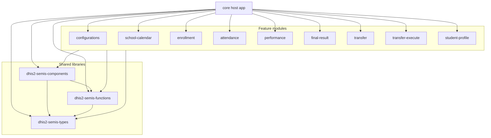

# SEMIS

SEMIS (School Education Management Information System) is a DHIS2 web app built by the DHIS2 for Education Team. It manages the **students** and **staff** of schools on top of the DHIS2 Tracker.

## Contents

1. [What SEMIS does](#1-what-semis-does)
2. [Installation and configuration](#2-installation-and-configuration)
3. [Architecture](#3-architecture)
4. [Development](#4-development)
5. [Glossary](#5-glossary)

---

## 1. What SEMIS does

| Area | What the user does |
|---|---|
| Configuration | Map DHIS2 programs, stages, data elements and attributes to SEMIS concepts; define profiles |
| School calendar | Define academic years, terms (class periods), school days and holidays |
| Enrollment | List, enroll (one by one or from a file), edit and delete students or staff |
| Attendance | Take and review daily attendance, mark all, class attendance status, import and export files |
| Performance | Capture marks per term, with program rule validation |
| Final result / Re-enroll | Record the end-of-year result and promote (re-enroll) to the next academic year |
| Transfers | Request a transfer at the origin school; approve or reject it at the destination school |
| Profile | Profile page per student or staff member: identity card, tabs, key indicators, photo |

Students and staff each have their own tracker program and their own SEMIS settings.

---

## 2. Installation and configuration

### 2.1 Requirements

- DHIS2 2.41 or later (tested on 2.41, 2.42 and 2.43).
- The SEMIS metadata on the instance: one tracker program for students and one for staff, with the stages SEMIS uses (enrollment, attendance, one performance stage per term, final result, transfer) and their option sets. The app does not create this metadata.
- No external services: the app only talks to the DHIS2 instance it is installed on.

### 2.2 Install the app

1. Get the app zip from the [GitHub releases](https://github.com/Saudigitus/dhis2-semis-core/releases).
2. In DHIS2, open **App Management**, choose **Upload app** and select the zip.
3. Add the SEMIS app to the user roles of the people who will use it.

### 2.3 Users and access

- **Administrators** need the `ALL` authority (superuser). Only they see **Configurations** and **School Calendar**, and they must be able to save the SEMIS settings in the data store (namespace `semis`).
- **School users** need a user role with the SEMIS app, their school(s) as data capture organisation units, and metadata read plus data read/write sharing on the student and staff programs and their stages.
- The app declares the `SEMIS-*` authorities, but screens are not restricted by them yet: access comes from the DHIS2 sharing settings.

### 2.4 First-time setup (as administrator)

1. **Programs.** For the student and the staff program: tracker program, access level `OPEN`, enrollment and incident dates in the future allowed (SEMIS sends the enrollment date as the incident date, and the user's time zone may be ahead of the server), enrolling the same person again allowed, and image attributes on the tracked entity type.
2. **Configurations.** Fill in every card of the **Student** and **Staff** sections:
   - **Enrollment:** enrollment stage, grade, class/section and the filters;
   - **Attendance:** attendance stage, status and absence reason, status options, attendance summary;
   - **Performance:** one stage per term, with the subjects;
   - **Final result / Re-enroll:** status, promotable statuses and dropout statuses. The dropout statuses are required: without them, *Perform promotion* and *Perform re-enrollment* stay disabled;
   - **Transfer:** transfer stage, destination school, and the pending, approved and rejected statuses;
   - **Profile.**

   Saving writes the settings to the data store (`semis/values`).
3. **School Calendar.** Add the current and the next academic year, with school days, terms (inside the year and not overlapping) and holidays. Promotion and re-enrollment only offer years that are in the calendar, so add the next year before the end of the school year. The calendar is saved in `semis/schoolCalendar`.
4. **Android (optional).** The SEMIS Android app reads `semis/android`. Opening Configurations creates it when it is missing, as `{"syncMode": "AUTO", "showAttendanceStatusPrograms": false}`.
5. **Check.** Log in as a school user, open SEMIS, select a school and an academic year, and open each module.

### 2.5 Messages at start-up

| Message | Meaning | What to do |
|---|---|---|
| No configuration found | The SEMIS settings do not exist yet | An administrator sets up both sections in Configurations |
| School calendar configuration not found | The school calendar has no academic year | An administrator sets up the School Calendar |
| Invalid configurations, or the offer to convert | The saved settings are incomplete or come from an older SEMIS version | An administrator reviews the settings in Configurations |

---

## 3. Architecture

### 3.1 Technology

| Concern | Technology |
|---|---|
| App platform | DHIS2 App Platform (`@dhis2/cli-app-scripts`, Vite), `@dhis2/app-runtime` |
| Language | TypeScript |
| UI | `@dhis2/ui` and MUI |
| State | Recoil |
| Routing | `react-router-dom` with `HashRouter` (`#/semis/...`) |
| Forms and validation | `react-final-form`; `zod` for the settings schema |
| Program rules | `@dhis2/rule-engine` |
| Files | `exceljs`, `xlsx`, `file-saver` (import and export) |
| Dates | `date-fns` |
| Translations | `@dhis2/d2-i18n` (en, fr, pt) |
| Data | DHIS2 Web API: `tracker`, `programs`, `dataStore/semis`, `analytics`, `fileResources`, `me`, `system/info` |

### 3.2 Packages

This repository is the host app. The libraries and the feature modules are git submodules, and the app builds them **from their TypeScript source** through path aliases (`viteConfigExtensions.mts` and `tsconfig.json`).

| Package | Path | Repository | Role |
|---|---|---|---|
| core | `.` | `dhis2-semis-core` | Host app: start-up, routing, layout, menu, home |
| `dhis2-semis-components` | `src/libs/components` | `dhis2-semis-components` | Shared UI: app wrapper, tables, forms, import/export, header, layouts |
| `dhis2-semis-functions` | `src/libs/functions` | `dhis2-semis-customfunc` | Shared hooks and utilities: data fetching, URL parameters, program rules, dates |
| `dhis2-semis-types` | `src/libs/types` | `dhis2-semis-types` | Shared types and the settings schemas |
| `dhis2-semis-configurations` | `src/modules/configurations` | `dhis2-emis-config` | Configuration screens, saved in `semis/values` |
| `dhis2-semis-school-calendar` | `src/modules/school-calendar` | `dhis2-emis-school-calendar` | Calendar editor, saved in `semis/schoolCalendar` |
| `dhis2-semis-enrollment` | `src/modules/enrollment` | `dhis2-semis-enrollment` | Enrollment |
| `dhis2-semis-attendance` | `src/modules/attendance` | `dhis2-semis-attendance` | Attendance |
| `dhis2-semis-performance` | `src/modules/performance` | `dhis2-semis-performance` | Marks per term |
| `dhis2-semis-final-result` | `src/modules/final-result` | `dhis2-semis-final-result` | Final result and re-enrollment |
| `dhis2-semis-transfer` | `src/modules/transfer` | `dhis2-semis-transfer` | Incoming and outgoing transfers, approve or reject |
| `dhis2-semis-transfer-execute` | `src/modules/transfer-execute` | `dhis2-semis-transfer-execute` | Transfer requests |
| `dhis2-semis-student-profile` | `src/modules/student-profile` | `dhis2-semis-student-profile` | Profile page |

All repositories are public under [github.com/Saudigitus](https://github.com/Saudigitus).



Modules never import each other. They share information only through the URL, the shared Recoil state and the DHIS2 server.

### 3.3 How a module is plugged in

1. **Source.** `viteConfigExtensions.mts` maps `dhis2-semis-<name>` to `./src/{libs,modules}/<name>/src`, and `tsconfig.json` mirrors it in `paths`.
2. **Mounting.** `src/router/routeList.tsx` imports the root component of each module and mounts it under `/semis/...`, passing `{ i18n, baseUrl }`.
3. **Providers.** Modules use the core's `AppWrapper` (data provider, Recoil and router), so they do not run on their own.
4. **Settings.** Each module reads the settings of its section (student or staff) and the matching program.

### 3.4 Start-up

```
DHIS2 platform shell (data provider, header bar, alerts, locale)
└─ src/app/app.tsx
   └─ AppWrapper (components)
      ├─ GET dataStore/semis/values           → SEMIS settings
      ├─ GET programs/{id} for each section   → program metadata
      ├─ GET dataStore/semis/schoolCalendar   → school calendar
      ├─ GET system/info                      → API version
      └─ InitializeWrapper (core)
         ├─ GET me                            → user
         └─ RulesEngineWrapper (functions)
            ├─ program rules, variables, option groups,
            │  organisation unit groups, constants
            └─ Router (HashRouter) → /semis layout (side bar + module)
```

### 3.5 Routes

| Route | Module |
|---|---|
| `/semis` | Home |
| `/semis/enrollments` | enrollment |
| `/semis/attendance` | attendance |
| `/semis/performance` | performance (students) |
| `/semis/final-result` | final-result (students) |
| `/semis/re-enroll` | final-result (staff) |
| `/semis/transfer` | transfer |
| `/semis/transfer-execute` | transfer-execute |
| `/semis/profile/*` | student-profile |
| `/semis/configuration/*` | configurations (administrators) |
| `/semis/school-calendar/*` | school-calendar (administrators) |

### 3.6 URL parameters

Every module shares these parameters: `school`, `schoolName`, `academicYear`, `sectionType` (`student` or `staff`), `grade`, `class`, `position`, `employmentType`, `programStage`, `attendanceMode`, `selectedDate`, plus the codes of the configured filters. The header reads and writes them. Most modules show an information page until a school, an academic year and the configured filters are selected.

### 3.7 Data store

| Key | Written by | Content |
|---|---|---|
| `semis/values` | Configurations | One entry per section (`student`, `staff`): program, enrollment, attendance, performance, final result, transfer, socio-economics, filters, defaults and profile |
| `semis/schoolCalendar` | School Calendar | The academic year data element, the default academic year, and per academic year the school days, terms and holidays |
| `semis/android` | Configurations | Settings of the SEMIS Android app |

### 3.8 Tracker data model

- **One tracker program per section** (student and staff).
- **Enrollment stage:** one event per enrollment with academic year, grade and class/section. It is the row of most tables.
- **Attendance stage:** one event per person and day (status and absence reason), plus an optional class summary.
- **Performance stages:** one stage per term; the marks are data elements of that stage.
- **Final result stage:** the status; dropout statuses cancel the enrollment, the others complete it.
- **Transfer stage:** status (pending, approved, rejected) and destination school.
- **Socio-economics stage:** extra enrollment data, copied on re-enrollment.

Data is saved through `POST tracker`, plus `PUT tracker/ownership/transfer` for transfers and `POST fileResources` for photos.

### 3.9 Program rules

`dhis2-semis-functions` wraps `@dhis2/rule-engine`. Rules, variables, option groups, organisation unit groups and constants are loaded once at start-up. Supported actions: assign, hide field, hide section, show error, show warning, set mandatory field, hide option, show and hide option group. The enrollment form, the performance cells and the profile form use them.

### 3.10 Translations

The core registers `en`, `fr` and `pt` from `src/locales/*/translations.json`; the language follows the user's DHIS2 settings. `npm start` and `npm run build` extract the strings from `src`, which includes every submodule.

---

## 4. Development

### 4.1 Prerequisites

- Node.js 22.
- npm.
- A DHIS2 user on the instance you develop against.

### 4.2 Setup

```bash
git clone https://github.com/Saudigitus/dhis2-semis-core
cd dhis2-semis-core
git checkout develop
git submodule update --init --recursive

npm install -f
npx d2-app-scripts start --proxy https://<your-dhis2-instance>/
```

`-f` is needed because `package.json` lists the Windows-only `@rollup/rollup-win32-x64-msvc` as a regular dependency. The app is served at `http://localhost:3000`; log in with a user of the proxied instance.

### 4.3 npm scripts

| Script | What it does |
|---|---|
| `start` | Runs the app in development mode, proxied to the team's development instance |
| `build` | Builds the app; the zip to install is in `build/bundle` |
| `build-unix` | Same as `build`, with more memory for Node.js on Linux and macOS |
| `test` | Runs the tests (`d2-app-scripts test`) |
| `test:rules` | Runs the program rule tests |
| `deploy` | Deploys the built app to a DHIS2 instance |
| `init` | Adds the submodules (first-time repository setup) |
| `branch:create` | Creates and pushes the same branch in the core and every submodule |
| `branch:switch` | Switches the core and every submodule to the same existing branch |

`branch:create` and `branch:switch` check every repository first (local changes, unfinished git operations, missing or conflicting branches, access to `origin`) and restore the previous state if something fails. They work from Git Bash and PowerShell on Windows, and from Linux and macOS terminals:

```bash
npm run branch:create -- feat/my-change
npm run branch:switch -- develop
```

### 4.4 Working with submodules

- The core stores a **commit** per submodule, not a branch. The `branch` in `.gitmodules` is only used by `git submodule update --remote`.
- `ignore = all` hides submodule changes from `git status` and `git diff`, **but `git add .` still stages them**. Before committing in the core, check:
  ```bash
  git submodule status                          # "+" = not at the recorded commit
  git diff --cached --ignore-submodules=none    # submodule pointers in this commit
  ```
- Order of work: commit and **push** in the submodule, then `git add <submodule path>` in the core, then commit and push the core. Pushing the core first leaves others with `fatal: … not our ref`.
- After `git pull` in the core, run `git submodule update --init --recursive`: pull does not move submodules.
- Release branches are cut from `develop`. A fix made on a release branch must be merged back into `develop` in every repository it touches.

### 4.5 Environment

- The app uses no `.env` variables; the DHIS2 address comes from the platform.
- Everything else is configured at runtime from the data store keys in [3.7](#37-data-store).

### 4.6 Learn more

- [DHIS2 App Platform](https://platform.dhis2.nu/)
- [DHIS2 App Runtime](https://runtime.dhis2.nu/)

---

## 5. Glossary

| Term | Meaning |
|---|---|
| **Section / `sectionType`** | `student` or `staff`: selects the SEMIS settings and the tracker program in use. |
| **Core** | `dhis2-semis-core`, the host app that mounts every module. |
| **Submodule pointer** | The commit of a submodule recorded in a core commit. |
| **Enrollment stage / event** | The stage and event with academic year, grade and class; one per enrollment. |
| **Academic year** | An entry of the school calendar, and the data element that stores it on events. |
| **Term / class period** | A date range inside an academic year; performance uses one program stage per term. |
| **Final result** | End-of-year status; dropout statuses cancel the enrollment, the others complete it. |
| **Re-enroll / promote** | Creates a new enrollment of the same person for the next academic year. |
| **Transfer request** | An event of the transfer stage, created at the origin school with a pending status and a destination school. |
| **Ownership transfer** | Moves the program ownership of a person to another organisation unit. |
| **TEI / TEA / DE / OU** | Tracked entity instance / tracked entity attribute / data element / organisation unit. |
| **Program rule** | DHIS2 rule evaluated in the browser by `@dhis2/rule-engine`. |
